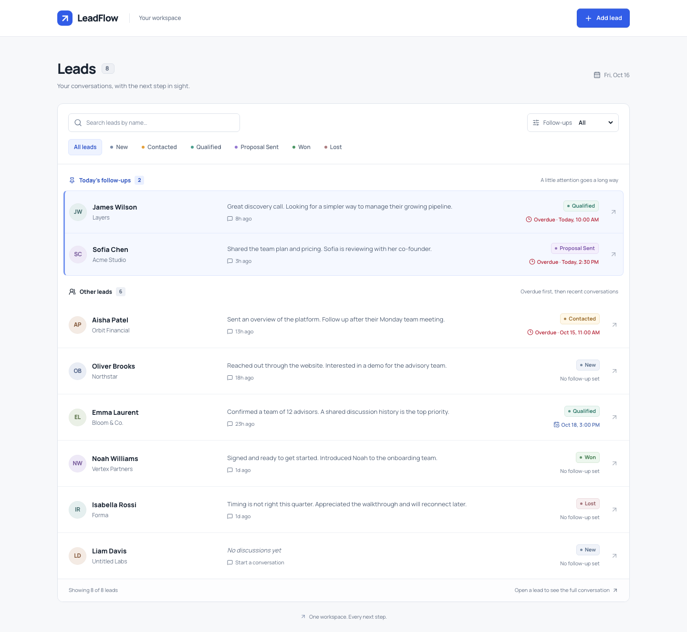

# LeadFlow

A focused workspace for leads, conversations, and the next follow-up. Built for the
PravarAI fullstack assessment with **Next.js, FastAPI, and SQLite**.

[Verified CI: 48 tests, production build, and Docker persistence](https://github.com/Arshkumar-elite/PravarAI/actions/runs/38925192304).



## What works

- Lead list with name, status, latest note, and relative discussion time.
- Today's follow-ups pinned at the top; overdue reminders explicitly highlighted in red.
- Timeline dialog with newest discussions first, note composer, and optional date/time.
- Successful saves update the list immediately; status and notes persist after reload.
- Add lead with required name, optional company/phone, and default New status.
- All six statuses, case-insensitive name search, and combined reminder/status filters.
- Responsive layouts, keyboard-accessible dialogs, focus restoration, and clear errors.
- Docker Compose, persistent database volume, and an idempotent seed command.
- Automated API, UI logic, browser, and accessibility tests.

This is a **single-user local demo**. It does not require login, AI API keys, paid services,
or cloud hosting. Follow-ups are in-app reminders; no email or push notification is sent.

## Start with Docker Compose

Prerequisites: Git and a running Docker engine with Docker Compose v2.

```bash
git clone https://github.com/Arshkumar-elite/PravarAI.git
cd PravarAI
cp .env.example .env
docker compose up --build -d --wait
docker compose exec api /app/.venv/bin/python -m app.seed
```

Open **http://localhost:3000**. API documentation: **http://localhost:8000/docs**.
The seed creates eight fictional leads and fourteen discussions. It uses today's date
in `SEED_TIMEZONE` (Asia/Kolkata by default). Running it again preserves existing data
and does not duplicate leads or discussions. Existing demo dates are not silently shifted.

```bash
docker compose logs -f
docker compose stop
docker compose start
```

The named `leadflow-data` volume retains data across container restarts and ordinary
`docker compose down`. Do not remove that volume if you want to retain your leads.
Stop native servers on ports 3000/8000 before starting Compose.

## Start without Docker

Prerequisites: **Node.js 24**, npm, **Python 3.13**, and **uv 0.11.28**.
The repository includes npm and uv lockfiles. Use `npm ci` and `uv sync --frozen` for
reproducible dependency installation.

From the repository root, start the backend in one terminal:

```bash
cd backend
cp .env.example .env
uv sync --frozen
uv run python -m app.seed
uv run uvicorn app.main:app --host 127.0.0.1 --port 8000
```

In another terminal, from the repository root:

```bash
cd frontend
cp .env.example .env.local
npm ci
npm run dev
```

Open **http://127.0.0.1:3000**. Native data is stored in
`backend/data/leadflow.db`, which is ignored by Git. Run backend commands from `backend/`
so relative paths and its `.env` resolve consistently.

## Configuration

| Variable | Location | Default / meaning |
| --- | --- | --- |
| `NEXT_PUBLIC_API_URL` | Root Compose `.env`; frontend `.env.local` | `http://localhost:8000/api`; public browser API URL, embedded at build time |
| `DATABASE_URL` | Backend `.env` | `sqlite:///./data/leadflow.db`; Compose fixes this to `/app/data/leadflow.db` |
| `CORS_ORIGINS` | Root Compose `.env`; backend `.env` | `http://localhost:3000,http://127.0.0.1:3000` |
| `SEED_TIMEZONE` | Root Compose `.env`; backend `.env` | `Asia/Kolkata`; only controls seed calendar dates |

There are no required secrets. Rebuild the frontend after changing its public API URL.
The viewer's browser timezone controls displayed follow-ups regardless of seed timezone.
Compose exposes both ports on `127.0.0.1` only.

## Testing

Backend:

```bash
cd backend
uv run ruff check app tests
uv run ruff format --check app tests
uv run pytest -q
```

Frontend:

```bash
cd frontend
npm run lint
npm run typecheck
npm run test
npm run build
npx playwright install chromium webkit
npm run test:e2e
```

On Linux, install browser OS dependencies with
`npx playwright install --with-deps chromium webkit`.

Browser tests start their own frontend/API on ports **3001/8001**, with a temporary
database and deterministic seed date. They never reuse the developer database. Leave
those two ports free. Chromium runs the complete suite; WebKit runs the core flow.
The tests cover failed saves, reload persistence, combined filters, midnight/DST behavior,
keyboard focus, mobile interaction, page overflow, and axe accessibility scans.

The GitHub Actions workflow also builds Compose, seeds it, restarts the API, and compares
the before/after data. See [verification results](docs/TESTING.md) for actual results and
environment limitations, rather than assuming a configured check has passed.

## Screenshots and walkthrough

- [Desktop](docs/screenshots/workspace-1440.png)
- [Timeline](docs/screenshots/timeline.png)
- [Add lead](docs/screenshots/add-lead.png)
- [Mobile workspace](docs/screenshots/workspace-390.png)
- [Mobile timeline](docs/screenshots/mobile-timeline.png)
- [Overdue filter](docs/screenshots/overdue.png)
- [Recorded walkthrough](docs/video/leadflow-walkthrough.webm)

The walkthrough is a scripted recording of the working application, without narration.
It demonstrates lead creation, note entry, follow-up pinning, status persistence, search,
overdue filtering, and a mobile save. To regenerate it against an isolated demo database:

```bash
cd frontend
npm run demo
```

## Architecture and decisions

The frontend is organized around the workspace, lead rows, add-lead dialog, timeline,
and composer. FastAPI separates HTTP routes, validation schemas, persistence models,
and transactional discussion operations. TanStack Query updates both list and detail
from the server's save response before revalidation.

All timestamps are stored and returned as UTC. A note without a follow-up preserves the
existing reminder; an explicit clear action removes it. Today's overdue reminders remain
pinned. Search and filters apply to all groups without duplicate leads.

Read the [architecture and API contract](docs/ARCHITECTURE.md),
[design rationale and references](docs/DESIGN.md), and
[implementation milestones](docs/IMPLEMENTATION.md).

Intentional tradeoffs: SQLite for a portable local demo, client-side filtering for this
small dataset, initial schema creation rather than a migration framework, and last-write-wins
across independent clients. Multi-user authentication, pagination, idempotency keys,
versioned updates, and external notification delivery are future work.

## AI assistance and attribution

This submission was built with AI assistance. See [AI usage disclosure](docs/AI_USAGE.md)
for the tools, generated work, design references, review process, and limitations.
The implementation does not call an AI model at runtime.
